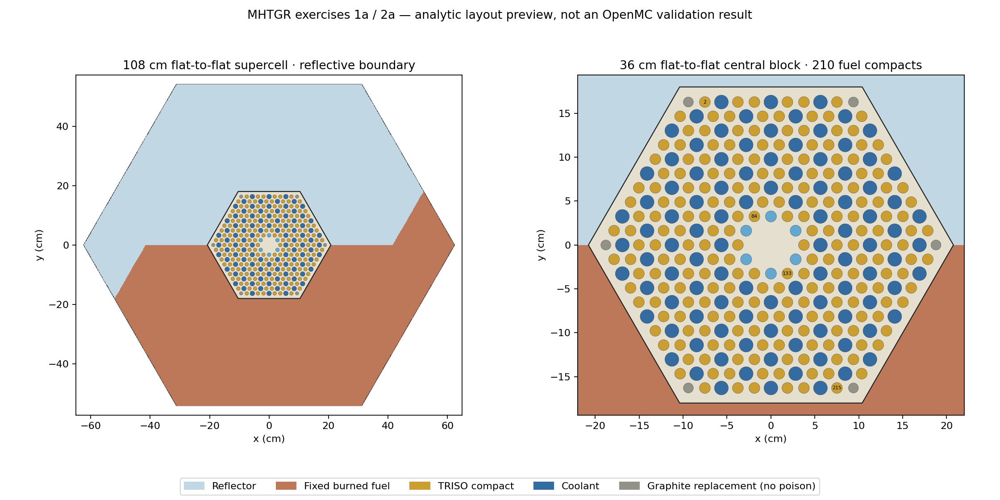

# MHTGR-350 numerical benchmark workflow

**Current status:** both completed cold comparisons failed their numerical
screens. The current cold, pilot and depletion cases use **advisory** benchmark
policy at the user's request: a completed calculation/report/upload can succeed
while the report explicitly retains `screening_fail` and `not_validated`.
See [the exploratory production guide](exploratory-production.md) for the current
run policy. The [baseline audit](audits/cold-baseline-review.md) preserves the
earlier strict-policy investigation and findings.

This implements **Phase III exercises 1a and 2a (without burnable poisons)**.
It is a candidate OpenMC implementation: an AWS geometry check completed, but
benchmark agreement and convergence remain unresolved. It is not a verified Antares model, an experimental
validation, or a claim that the OECD/NEA benchmark has already been reproduced.

## Reference and scope

- Geometry/compositions: [Volume III, draft 15 January 2015](https://www.oecd-nea.org/upload/docs/application/pdf/2021-11/mhtgr-350-vol_iii-benchmark_lattice.r0.pdf), Tables III-1–4 and Figures III-1/III-3.
- Comparisons: [NEA/NSC/R(2019)6, corrected 16 October 2020](https://www.oecd-nea.org/upload/docs/application/pdf/2021-11/nea_nsc_r_2019_6_cancel_and_replace_16_oct_2020_2020-10-16_15-07-51_660.pdf), Table 4 (printed page 13) and Table 11 (printed page 21). This corrected report cites the 2015 Volume III specification.
- `specification.json` and `reference.json` record URLs and SHA-256 hashes of the source PDFs. Numerical values are transcribed, not fitted to an OpenMC result. PDF files are not redistributed here.
- Published means and code-to-code spread are retained alongside individual Monte Carlo results. These are numerical reference solutions, not measured criticality data.
- Only multiplication factors have an automated reference comparison. Pinwise inventories are exported for later comparison; no inventory validation is claimed. Exercises 1b/2b with burnable poisons, two-group cross-sections and the complete reporting XML are not implemented.

## Geometry and materials

The central hexagon is 36 cm across flats; the outer supercell is 108 cm across
flats. Both have horizontal top/bottom faces in the xy plane. The central lattice
uses a 1.88 cm triangular pitch and includes 210 fuel compacts, 102 large coolant
channels, six small coolant channels, seven central graphite sites and six corner
graphite replacements for the absent poison. Fuel positions are numbered in the
published order; coolant positions are skipped and corner replacements included.

Fuel compacts have 0.6225 cm radius with a helium gap to 0.635 cm. Large and small
coolant radii are 0.794 and 0.635 cm. Explicit five-layer TRISO spheres have outer
radii 0.02125, 0.03125, 0.03475, 0.03825 and 0.04225 cm; target packing fraction
is 0.35. Composition uses the published **absolute atom/barn-cm densities**, including
the prescribed C-12/C-13 split. Carbon marked `C_graph` uses graphite thermal
scattering; `C_nat` does not. Six corner poison positions are replaced by block
graphite, without retaining helium holes there.

The three upper neighboring regions are graphite reflector; the three lower regions
are the fixed homogenized burned-fuel mixture. Their interface continues diagonally
through the partial outer blocks, following Figure III-1. Both surrounding materials
are non-depleting, even though the burned region contains fissile isotopes.

This is an **axially uniform lattice exercise** implemented with a 1 cm reflective
slice, not a 79.3 cm finite reactor element. All outer surfaces are reflective. It
contains no fuel-handling holes or axial end caps absent from the lattice figure.
Each compact has a separate depletion material and its actual kernel volume.
The same deterministic random TRISO packing is reused in each compact, with
different fuel compositions. Packing realization, finite sphere count and axial
slice height are discretization choices; compare alternative seeds and 2 cm slices
before claiming convergence. Do not change dimensions to force agreement with k.



This drawing comes from the analytic pin map, not an OpenMC plot. AWS-generated
plots must be inspected separately. Grey corner markers indicate graphite
replacement locations; there is no physical grey-material hole in the model.

## What the checks establish

Static tests check counts, published numbered anchors, rotational symmetry,
all hole-pair separations, face clearances, burnup schedules and comparison
failure behavior. They import no OpenMC and run no nuclear calculations.

On AWS, model construction checks TRISO pair separation, sphere containment,
realized packing fraction, equal packings across MPI ranks and source locations
inside all 210 intended fuel materials. `mhtgr-geometry` additionally runs OpenMC
geometry-debug and writes xy/xz plots. Inspect its log for unvisited/unchecked cells:
a successful sampled geometry-debug run is not a mathematical proof of all geometry.

Automatic material-cell offset tables are disabled: the model uses one distinct
material per compact, ordinary cell tallies and material-based depletion, not
distributed-cell/instance tallies. The first AWS geometry run exhausted its 28 GiB
limit during offset preparation for plotting. This change targets that allocation;
peak memory and successful geometry-debug still need verification on AWS. The
TRISO tracking grid has a 1e-8 cm numerical padding to avoid boundary-bin rounding;
physical compact/slice boundaries are unchanged. Any remaining out-of-grid TRISO
warning is treated as an error instead of silently continuing.

The optional `summary.h5` geometry export is disabled. The third AWS geometry
attempt remained at that write for over 30 minutes; EFS still had burst credits
and low reported PercentIOLimit. Serial HDF5 metadata operations are a suspected
bottleneck, not a proven deadlock. XML, plots and geometry-audit files retain the
geometry record; transport statepoints and depletion results remain enabled.

No benchmark simulation has been run by the coding assistant locally. There are
no fabricated current-model results in the reference files.

## Numerical settings and interpretation

Exercise 1a uses 293.6 K; exercise 2a uses 1200 K, 100 W/g initial heavy metal
and report points 0, 0.5, 5, 10, 20, ..., 100, 120 MWd/kgHM. Those burnup units
are numerically equal to GWd/tHM. Specific power is applied only to the central
depleting inventory via fission-Q normalization. The surrounding burned region
does not contribute to the specified central heavy-metal mass.

CE/CM integration resolves early burnup at 0.01, 0.05, 0.1, 0.2 and 0.5 MWd/kgHM,
then uses increments no larger than 1 MWd/kgHM. The full case has 125 intervals
and approximately 251 transport solves; it is substantially larger than the old
smoke case. Halve the maximum interval and compare before accepting timestep
convergence. There is no measured runtime estimate yet. The full job has a 24-hour
timeout and no implemented restart; use the pilot to assess cost first.

Cases currently use 50,000 particles, 250 batches and 100 inactive batches. These
are starting settings, not a claim of source convergence. The cold report includes
an entropy/generation-k plot. Repeat with more inactive batches and independent
transport seeds, examining source convergence as well as the reported uncertainty.

The current uploaded library is ENDF/B-VIII.0, while the specification encourages
ENDF/B-VII.0. Reports identify this as an exploratory library comparison. For a
closer reproduction, prepare a separately versioned VII.0 library and consistent
depletion chain; do not overwrite the existing EFS data version. Inspection of the
uploaded VIII.0 graphite HDF5 file showed temperature labels beginning at **296 K**.
The cold cases retain 293.6 K but permit a **3 K interpolation-endpoint tolerance**,
allowing the 296 K graphite table (and a nearby neutron-data endpoint) to be used.
This is a disclosed approximation, not an exact-temperature reproduction. Use
appropriately processed 293.6 K data for a stricter comparison. The hot case retains
a 0.5 K tolerance and
requires usable 1200 K data. Manifest, chain and cross-section XML hashes are saved.

Default **project screening limits**, not OECD acceptance criteria:

- Absolute difference from published mean: at most 500 in `Δk × 100,000` units.
- OpenMC estimated standard uncertainty: at most 50 in the same units.

The report separately gives reactivity difference `(1/k_ref - 1/k)*100000`.
Published code spread is not combined with Monte Carlo uncertainty to manufacture
a pass. A screening pass still says `validation_status: not_validated`; geometry,
library, source, packing and timestep reviews are separate requirements. These
initial screens are looser than the specification's convergence recommendation.

## Release and run on AWS

1. Commit all benchmark files, Docker changes and workflow/scripts on main. Push
   a new unused version tag. Wait for its publish job to pass. CI runs the pure
   contract tests before publication and submission.
2. In administrator CloudShell, fetch and check out that tag, then run
   `bash scripts/register-release.sh YOUR_TAG`. This registers four additional
   definitions as well as the existing ones. No simulation is submitted.
3. If GithubOIDC's existing `batch:SubmitJob` policy lists exact definition names,
   add the four new `block-mhtgr-*` definitions to its allowed resources, retaining
   the existing queue resource. No new IAM-management or PassRole permission is
   needed on GithubOIDC. Keep registration in CloudShell.
4. Use Run workflow on main. Select **mhtgr-geometry** and paste its new exact ARN
   into `job_definition_arn`. Inspect the uploaded plots, pin map, geometry audit
   and CloudWatch debug output. Do not proceed with unexplained errors/coverage gaps.
5. Optional for exploratory production: run **mhtgr-cold**, again with its own ARN. Inspect `comparison.html`/PNG and
   `source-convergence.png`. Resolve large deviations and test convergence before
   attempting depletion. Expected published mean is 1.23600 (Table 4); this is a
   reference value, not a prediction or measured result from our model.
6. Optional for exploratory production: run **mhtgr-pilot** on two nodes. It reaches 0.5 MWd/kgHM at 1200 K and compares
   both initial and final values to Table 11. Use elapsed time and file sizes to
   estimate the full campaign; don't scale the old smoke time blindly.
7. For the user-selected exploratory campaign, directly dispatch **mhtgr-depletion**:
   eight nodes, one MPI rank and 16 OpenMP threads per node. Full reference
   comparison runs automatically at completion. Skipping the preceding studies
   leaves their scientific and runtime uncertainties unresolved.

No production run, infrastructure mutation or tag push is performed by these
local edits. The older `geometry`, `smoke`, `mpi-smoke` and `production` stages still
run the original illustrative model and do not receive MHTGR comparison labels.

## Seeing results

The submit job summary gives the exact S3 output prefix. Single-node benchmark
runs use `runs/<Batch-job-id>/attempt-1/`; multinode runs use
`runs/gha-<GitHub-run-id>-<attempt>/attempt-1/`.

Download `comparison.html` together with `benchmark-comparison.png` and open the
HTML file locally, or view the PNG and `comparison.md` separately. Machine-readable
files are `comparison.csv` and `comparison.json`. Depletion also exports
`pin-inventories.csv` and retains `depletion_results.h5`; `run.json` records provenance.

With `benchmark_policy: advisory`, a completed numerical comparison does not fail
Batch solely for bias or uncertainty outside the screen. The report retains the
actual screen result and `validation_status: not_validated`. Set the case policy
to `strict` to restore numerical gating; omitted policies default to strict.
Thresholds and reference values are unchanged. Missing data, duplicate burnup
points, NaNs, wrong schedules, incomplete runs, report errors and failed uploads
still fail the workflow. A simulation crash before comparison leaves its logs and EFS files
but may not upload a comparison report. Publishing does not trigger paid jobs.

For local static checks only:

```bash
python -m unittest discover -s tests -v
```
